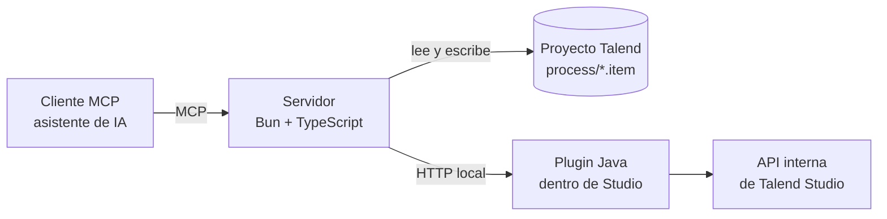

<div align="center">

<picture>
  <source media="(prefers-color-scheme: dark)" srcset="docs/media/logo-dark.svg">
  <source media="(prefers-color-scheme: light)" srcset="docs/media/logo-light.svg">
  
</picture>

**Servidor MCP local para crear, editar, compilar y ejecutar jobs de Qlik Talend Studio.**

[](https://github.com/AndresGaibor/talend-mcp/actions/workflows/ci.yml)


[Empezar](#empezar) · [Qué puedes hacer](#qué-puedes-hacer) · [Cómo funciona](#cómo-funciona) · [Estado](#estado-del-proyecto) · [Documentación](#documentación)

<br>


</div>

<br>

Talend MCP conecta un asistente compatible con [MCP](https://modelcontextprotocol.io/) con tus
proyectos de Talend Studio. El asistente puede leer el proyecto, crear y modificar jobs, compilarlos,
ejecutarlos y revisar el resultado, con una sola llamada de verificación que detecta avisos aunque el
job termine con código 0. Todo corre en tu equipo: el servidor escucha solo en `127.0.0.1` y tus
proyectos no salen de él.

## Qué puedes hacer

- **Explorar** jobs, componentes, contextos y resultados de ejecuciones, sin abrir Studio.
- **Crear y modificar jobs en vivo** en un Studio abierto: añadir componentes, definir schemas,
  conectar y configurar parámetros.
- **Trabajar en lote y sin Studio**: crear cientos de jobs desde una plantilla, editarlos de forma
  atómica y comprobar que compilan. Pensado para migraciones.
- **Verificar con `talend_job_verify`**: diseño, compilación, ejecución y búsqueda de `[WARN]`,
  `[ERROR]`, `[FATAL]` y excepciones en una sola llamada.
- **Dejar que el asistente te guíe.** No necesitas memorizar las herramientas: `talend_guide` indica
  la secuencia adecuada para cada tarea.

## Empezar

### Requisitos

- [Bun](https://bun.sh/) para instalar y ejecutar el servidor.
- Un proyecto de Talend Studio accesible desde el equipo.
- Talend Studio abierto, solo si quieres crear, modificar o ejecutar jobs en vivo.

### Instalar

```bash
git clone https://github.com/AndresGaibor/talend-mcp.git
cd talend-mcp
bun install
```

Indica dónde está tu proyecto en un archivo `.env.local`. La ruta debe señalar la carpeta que
contiene `talend.project`:

```dotenv
TALEND_PROJECT="C:/ruta/al/workspace/MI_PROYECTO"
```

### Iniciar

```bash
bun run start
```

El servidor queda disponible en `http://127.0.0.1:3927/mcp`. Configura esa dirección en tu cliente MCP
y pídele al asistente que use **`talend_guide`**.

`start` actualiza el plugin automáticamente si Studio está abierto y el bridge no responde. Para que no
lo toque, usa `bun run start --skip-bridge` o `bun run start:server`.

### Trabajo en vivo con Studio

Para operar sobre jobs abiertos hace falta el plugin incluido en este repositorio:

```bash
bun run bridge:install
```

El plugin conecta el servidor con Studio y normalmente se recarga sin reiniciarlo. Funciona en modo de
solo lectura por defecto: las acciones que modifican el proyecto requieren autorización explícita en el
entorno. Si no detecta Studio, define `TALEND_STUDIO_HOME` con la carpeta que contiene `plugins/` y
`features/`. Para revisar el estado completo, ejecuta `bun run doctor`.

### Otros clientes MCP

Si tu cliente usa `stdio`:

```json
{
  "mcpServers": {
    "talend-mcp": {
      "command": "bun",
      "args": ["run", "index.ts"],
      "env": {
        "TALEND_PROJECT": "<ruta-a-tu-proyecto>",
        "TALEND_MCP_FILTER": "agent"
      }
    }
  }
}
```

## Cómo funciona



El servidor expone **240 herramientas**, con nombres `talend_<área>_<verbo>`. No hace falta cargarlas
todas: `TALEND_MCP_FILTER` elige un preset, y `agent` (55 herramientas) es el recomendado para empezar.
`bun run mapa` muestra el recuento por preset.

El trabajo se reparte en dos caminos, según el caso:

| Trabajo | Camino |
|---|---|
| Migraciones, lotes y jobs cerrados | **Offline**: se escribe el job en disco, de forma atómica y sin Studio. |
| Jobs abiertos en un editor y componentes que Studio configura al conectar, como `tMap` | **En vivo**: a través del plugin de Studio. |

El detalle, con garantías y rendimiento, está en [Modo offline](docs/MODO-OFFLINE.md).

## Estado del proyecto

El soporte de componentes se mide por niveles, desde crear un nodo hasta ejecutar un job y comparar su
salida con el resultado esperado. Cifras en **Talend Studio 8.0.1**:

| Cobertura | Resultado más reciente | Qué significa |
|---|---:|---|
| Componentes básicos | **877 de 897** | Se pueden crear y configurar. |
| Componentes que compilan | **418 de 498 probados** | Talend generó y compiló el job de prueba. |
| Ejecuciones verificadas | **66 componentes, en 63 escenarios** | Se ejecutó el job y se comparó la salida con lo esperado. |

Estas cifras no implican que cada componente esté probado en todos los escenarios. Algunos necesitan
drivers, servicios externos o módulos que no están disponibles en el entorno de pruebas, y un componente
sin pruebas no está necesariamente fuera de soporte. Las pruebas con emuladores (S3, SQS) no sustituyen
una validación en AWS real.

El proyecto está en desarrollo activo. Hoy se trabaja en ampliar las pruebas por familia, resolver
dependencias que impiden medir algunos componentes (como la lectura de XLSX), probar más conectores de
bases de datos y servicios cloud, y validar una migración de SAS a Talend comparando resultados.

## Documentación

| Quieres... | Lee |
|---|---|
| Usar el MCP con un asistente | [Guía para asistentes](docs/GUIA-AGENTE.md) |
| Migrar o editar muchos jobs sin Studio | [Modo offline](docs/MODO-OFFLINE.md) |
| Ver qué herramientas hay | [Catálogo de herramientas](docs/CATALOGO-DE-TOOLS.md) |
| Saber qué componentes están probados | [Cobertura por familia](docs/COBERTURA-POR-FAMILIA.md) y [plan de pruebas](docs/PLAN-DE-PRUEBAS.md) |
| Entender cómo está organizado | [Arquitectura](docs/ARQUITECTURA.md) |
| Conocer el rumbo | [Hoja de ruta](docs/ROADMAP-DOMINIO-TALEND.md) |
| Instalar en Windows o WSL | [Windows y WSL](docs/windows-wsl.md) |
| Contribuir | [AGENTS.md](AGENTS.md) y [docs/README.md](docs/README.md) |

## Desarrollo

```bash
bun run verify       # typecheck, tests y validación de fixtures
bun run doctor       # estado de Studio, bridge, MCP y configuración
bun run mapa         # carpetas, herramientas por preset y estado del bridge
```

`bun run verify` debe pasar antes de cada commit.

## Configuración

Por defecto el servidor usa HTTP local. Estas variables ajustan el modo, el puerto o las herramientas
visibles:

| Variable | Uso |
|---|---|
| `TALEND_PROJECT` | Carpeta del proyecto (la que contiene `talend.project`). |
| `TALEND_WORKSPACE` | Ubicación del workspace, si no defines `TALEND_PROJECT`. |
| `TALEND_MCP_MODE` | `http` o `stdio`. |
| `TALEND_MCP_PORT` | Puerto HTTP (por defecto `3927`). |
| `TALEND_MCP_HOST` | Dirección de escucha (por defecto `127.0.0.1`). |
| `TALEND_MCP_FILTER` | Herramientas visibles: `agent` (por defecto en `start`), `core`, `canonical` o `all`. |
| `TALEND_MCP_MAX_BODY_BYTES` | Tope del cuerpo JSON-RPC (por defecto `1048576`). Al superarlo se responde 413. |
| `TALEND_MCP_MAX_RUNS` | Ejecuciones que se conservan en el historial (por defecto `200`); las mas viejas se borran con sus archivos. |
| `TALEND_MCP_RUNS_DIR` | Carpeta del historial de ejecuciones (por defecto `.talend-mcp/runs`). |
| `TALEND_MCP_TOOL_TIMEOUT_MS` | Plazo de una llamada a una tool (por defecto `600000`). Al vencer responde que no termino. |
| `TALEND_MCP_MAX_CONCURRENT_CALLS` | Llamadas a tools atendidas a la vez (por defecto `4`); el resto recibe servidor ocupado. |
| `TALEND_MCP_MAX_RESPONSE_BYTES` | Tope de una respuesta de tool (por defecto `16777216`); por encima responde error y pide paginar. |
| `TALEND_STUDIO_HOME` | Instalación de Studio (carpeta con `plugins/` y `features/`). |
| `TALEND_BRIDGE_AUTO_INSTALL` | `0` desactiva la actualización automática del plugin al arrancar. |
| `TALEND_MCP_LOG` | `quiet`, `normal` o `verbose` para los mensajes de los CLI. |
| `TALEND_LOG_DIR` | Carpeta donde buscar los logs de Studio para `talend_read_run_log`. |
| `TALEND_DISABLE_AUTODETECT` | `1` impide inferir el proyecto desde el workspace. |

## Solución de problemas

| Síntoma | Qué revisar |
|---|---|
| El asistente no encuentra el proyecto | La ruta de `TALEND_PROJECT`. |
| No aparecen jobs abiertos | Abre el job en Talend Studio. |
| No conecta con Studio | Que el plugin esté instalado y Studio abierto. Ejecuta `bun run doctor`. |
| No sabes si un componente está probado | La [cobertura por familia](docs/COBERTURA-POR-FAMILIA.md). |
