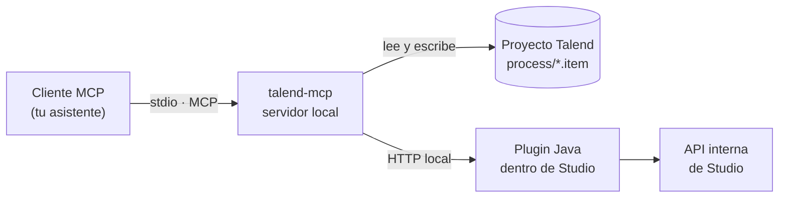

<div align="center">

<picture>
  <source media="(prefers-color-scheme: dark)" srcset="docs/media/logo-dark.svg">
  <source media="(prefers-color-scheme: light)" srcset="docs/media/logo-light.svg">
  
</picture>

**Deja que tu asistente de IA cree, edite, compile y verifique jobs de Qlik Talend Studio.**

[](https://github.com/AndresGaibor/talend-mcp/actions/workflows/ci.yml)
[](https://github.com/AndresGaibor/talend-mcp/releases/latest)
[](LICENSE)


[Instalar](#instalación) · [Qué puedes pedirle](#qué-puedes-pedirle) · [Cómo funciona](#cómo-funciona) · [Seguridad](#seguridad) · [Documentación](#documentación)

<br>


</div>

<br>

**Talend MCP** es un servidor [MCP](https://modelcontextprotocol.io/) local que conecta un asistente
(Claude, GitHub Copilot, Cursor, Codex, Gemini) con tus proyectos de Talend Studio. El asistente lee el
proyecto, crea y modifica jobs, los compila, los ejecuta y revisa el resultado. Todo corre en tu equipo:
tus proyectos no salen de él.

## Instalación

Un solo comando descarga el binario, comprueba su checksum y **configura los clientes MCP que tengas
instalados**. No hace falta clonar el repositorio ni instalar Bun.

**Windows (PowerShell)**

```powershell
irm https://github.com/AndresGaibor/talend-mcp/releases/latest/download/install.ps1 | iex
```

**Linux y macOS**

```bash
curl -fsSL https://github.com/AndresGaibor/talend-mcp/releases/latest/download/install.sh | sh
```

Reinicia tu cliente y pídele:

> Ejecuta `talend_guide` con `mode: overview`.

Si responde con el mapa de tareas, está listo. Para **actualizar**, vuelve a ejecutar el instalador.

<details>
<summary><b>Clientes que configura</b> y cómo controlarlo</summary>

<br>

| Cliente | `--client` |
|---|---|
| Claude Code | `claude-code` |
| Claude Desktop | `claude-desktop` |
| GitHub Copilot (VS Code) | `vscode` |
| Cursor | `cursor` |
| Gemini CLI | `gemini` |
| Codex CLI | `codex` |

```bash
talend-mcp setup --dry-run                      # ver qué haría, sin escribir nada
talend-mcp setup --client cursor,vscode         # solo algunos clientes
talend-mcp setup --project "C:/ruta/al/proyecto" # fijar el proyecto de Talend
talend-mcp remove                               # desinstalar de los clientes
```

`setup` solo añade la entrada `talend-mcp`: no toca tus otros servidores, guarda una copia
`<archivo>.bak-talend-mcp` y deja intacto cualquier archivo que no sea JSON válido. Para configurarlo a
mano, o si algo falla, mira [Instalación por cliente](docs/INSTALACION-CLIENTES.md).

</details>

<details>
<summary><b>Plugin de Claude Code</b> (skill + servidor)</summary>

<br>

Con el binario instalado, el plugin añade la skill que enseña al asistente el flujo correcto y registra
el servidor:

```
/plugin install talend-mcp --marketplace AndresGaibor/talend-mcp
```

</details>

<details>
<summary><b>Trabajo en vivo con Studio</b>: plugin Java</summary>

<br>

Para crear y editar jobs **abiertos** en Studio hace falta el plugin del bridge. Cada release incluye su
update site, `talend-bridge-p2.zip`: en Studio, **Help › Install New Software › Add › Archive**, elige el
zip e instala. Sin el plugin sigue funcionando el [modo offline](docs/MODO-OFFLINE.md) (lotes,
migraciones y jobs cerrados).

Si Studio no se detecta, define `TALEND_STUDIO_HOME` con la carpeta que contiene `plugins/` y
`features/`. `talend-mcp doctor` muestra el estado completo.

</details>

## Qué puedes pedirle

No hace falta memorizar herramientas: `talend_guide` indica al asistente la secuencia adecuada para cada
tarea. Ejemplos de peticiones:

> *«Lista los jobs del proyecto y dime cuáles usan `tMap`.»*
>
> *«Crea un job que lea `clientes.csv`, filtre `monto > 1000` y escriba `salida.csv`. Compílalo y verifícalo.»*
>
> *«Pasa estos 40 jobs del contexto PROD a QA, en lote, y comprueba que compilan.»*
>
> *«`CARGA_VENTAS` termina con código 0 pero algo falla. Revísalo.»*

| Capacidad | Para qué |
|---|---|
| **Explorar** | Leer jobs, componentes, conexiones, contextos y ejecuciones, sin abrir Studio. |
| **Crear y editar en vivo** | Añadir componentes, definir schemas, conectar y configurar en un Studio abierto. |
| **Trabajar en lote, sin Studio** | Crear y editar cientos de jobs de forma atómica. Pensado para migraciones. |
| **Verificar** | `talend_job_verify` encadena diseño, compilación y ejecución, y detecta `[WARN]`, `[ERROR]`, `[FATAL]` y excepciones **aunque el job termine con código 0**. |

## Cómo funciona



El trabajo sigue uno de dos caminos, según el caso:

| Trabajo | Camino |
|---|---|
| Migraciones, lotes y jobs cerrados | **Offline**: se escribe el job en disco, de forma atómica y sin Studio. |
| Jobs abiertos en un editor y componentes que Studio configura al conectar, como `tMap` | **En vivo**: a través del plugin de Studio. |

> [!NOTE]
> Nunca se edita en disco un job abierto en Studio: lo pisaría al guardar. Las herramientas offline lo
> detectan y lo rechazan.

El servidor expone más de doscientas herramientas (`talend_<área>_<verbo>`), pero por defecto solo
publica las del ciclo habitual de un job (preset `agent`). El resto se descubre bajo demanda con
`talend_search`. Detalle y garantías en [Modo offline](docs/MODO-OFFLINE.md).

## Seguridad

- **Local**: stdio o `127.0.0.1`. Escuchar fuera de loopback exige `TALEND_MCP_TOKEN`.
- **Cada herramienta tiene un riesgo** y el servidor lo aplica, no el asistente:

| Riesgo | Por defecto | Cómo cambiarlo |
|---|---|---|
| Leer | Permitido | — |
| Escribir | Permitido | `TALEND_MCP_ALLOW_WRITE=0` |
| Ejecutar jobs | Permitido, con `confirm: true` | `TALEND_MCP_ALLOW_EXECUTE=0` |
| Destructivo (borrar, restaurar) | **Bloqueado** | `TALEND_MCP_ALLOW_DESTRUCTIVE=1` y `confirm: true` |

- **Auditoría**: cada llamada queda en `.talend-mcp/audit.jsonl` (herramienta, riesgo, resultado y
  duración; nunca los argumentos).
- **Binarios verificados**: el instalador no instala si el SHA-256 no coincide con `checksums.txt`. Los
  binarios no están firmados.

Más en [SECURITY.md](SECURITY.md).

## Estado del proyecto

El soporte de componentes se mide por niveles, desde crear un nodo hasta ejecutar un job y comparar su
salida con el resultado esperado. Foto del 22/10/2026 en **Talend Studio 8.0.1**:

| Nivel | Resultado | Qué significa |
|---|---:|---|
| Componentes básicos | **877 de 897** | Se pueden crear y configurar. |
| Compilan | **418 de 498 probados** | Talend generó y compiló el job de prueba. |
| Ejecución verificada | **66 componentes, 63 escenarios** | Se ejecutó y se comparó la salida con lo esperado. |

Algunos componentes necesitan drivers o servicios externos que el entorno de pruebas no tiene, y uno sin
pruebas no está necesariamente fuera de soporte. Las pruebas con emuladores (S3, SQS) no sustituyen una
validación en AWS real. Detalle por familia en [Cobertura](docs/COBERTURA-POR-FAMILIA.md).

## Documentación

| Quieres... | Lee |
|---|---|
| Conectar un cliente a mano o resolver un fallo de instalación | [Instalación por cliente](docs/INSTALACION-CLIENTES.md) |
| Saber cómo trabajar con el MCP desde un asistente | [Guía para asistentes](docs/GUIA-AGENTE.md) |
| Migrar o editar muchos jobs sin Studio | [Modo offline](docs/MODO-OFFLINE.md) |
| Ajustar variables, reintentos idempotentes o ejecuciones asíncronas | [Configuración](docs/CONFIGURACION.md) |
| Usar la línea de comandos | [CLI](docs/CLI.md) |
| Ver todas las herramientas | [Catálogo de herramientas](docs/CATALOGO-DE-TOOLS.md) |
| Saber qué componentes están probados | [Cobertura](docs/COBERTURA-POR-FAMILIA.md) y [plan de pruebas](docs/PLAN-DE-PRUEBAS.md) |
| Resolver problemas con Studio o el bridge | [Solución de problemas](docs/SOLUCION-DE-PROBLEMAS.md) |
| Usarlo en Windows con WSL | [Windows y WSL](docs/windows-wsl.md) |
| Entender cómo está organizado | [Arquitectura](docs/ARQUITECTURA.md) |
| Conocer el rumbo | [Hoja de ruta](docs/ROADMAP-DOMINIO-TALEND.md) |

## Desarrollo

```bash
git clone https://github.com/AndresGaibor/talend-mcp.git && cd talend-mcp
bun install
bun run verify        # typecheck, tests y validación de fixtures: debe quedar en verde
bun run start         # servidor HTTP en http://127.0.0.1:3927/mcp
bun run mapa          # estructura del repo, herramientas por preset y estado del bridge
```

Las reglas del repositorio están en [AGENTS.md](AGENTS.md) y la guía para contribuir en
[CONTRIBUTING.md](CONTRIBUTING.md). Los cambios por versión, en [CHANGELOG.md](CHANGELOG.md).

## Licencia

[MIT](LICENSE) © 2026 Andres Gaibor
